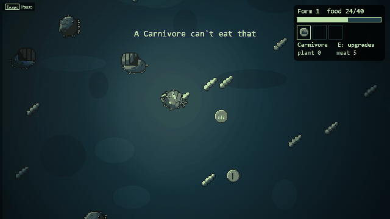
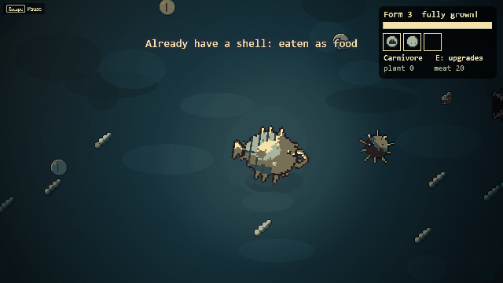

# Ooze2Orbit

**Eat, fight and evolve your way up from a single cell, in a dark little pond under the microscope.**

### ▶ [Play it in your browser: bamf69.github.io/Ooze2Orbit](https://bamf69.github.io/Ooze2Orbit/)

No install, no account. Keyboard or mouse; a gamepad works for swimming.



## What it is
Ooze2Orbit is a top-down evolution game. You start as a single cell and build your creature from what you eat and
what you beat. Right now it is a **toy**: the first stage (the cell stage) is playable, the rest (aquatic,
creature, civilization, space) is the plan. It is a prototype, so expect rough edges, and tell us what you think.

- **Pick a diet.** Herbivores eat glowing algae, carnivores eat the meat other cells drop, omnivores eat both at half
  value. You choose at the start and can switch every time you evolve.
- **Spend what you eat.** Algae earns plant points for **defense** and **mobility**; meat earns meat points for
  **attack** and **speed**. Every upgrade shows on your cell: a tail fin, side paddles, an outer membrane, mandibles.
- **Feel the weight.** Your cell has momentum, more with every form; mobility upgrades bring back snappy handling.
- **Collect parts.** Dead cells drop the part they wear and their meat, whatever killed them (the pond's creatures
  bump and fight each other too): spikes, a shell or a filter mouth. Each one changes your
  look and how you play. Slots are limited, so a new part replaces your oldest.
- **Survive the gulpers.** Big predators hunt you, and more of them each time you evolve. They also hunt the small
  cells and get distracted by them, so you can lure one onto a snail and slip away. Once they have eaten, or chased
  you for a while, they rest.
- **Evolve twice.** Fill your food meter to grow into a bigger form with room for more parts.
- **Tense but fair.** Bumps and bites cost food, never the run: there is no game over.

| | |
|---|---|
|  |  |
| *Pick your diet at the start and at every evolution* | *A gulper on the hunt* |
|  |  |
| *A herbivore: defense shows as an outer membrane* | *A fully grown carnivore: mandibles, thorns, shell, tail fin* |



## The aquatic stage (prototype)
Pick **Aquatic stage (prototype)** on the main menu: swim from a pond to a lake to the coast, seen from behind your
creature, from the seabed to the surface; each time you grow a form, breach in the river mouth's light and shoot a
fast river run to the next water (with a part you can only find there). Eat algae and plankton for plant points, ram creatures (dash into them) for meat and their
parts, spend points on five stats up to 10 (**E**), grow through three forms (the more aggressive, the more
shark-like), and flee spinefish and deepmaws (a red
edge and a low throb warn you when one is out of view). Press **U** to look down the lens as the Gardener: change
the water's temperature, press **Enter** to let a generation pass, and watch your kin's bodies change.

Keys: **W/S** swim, **A/D** turn, **R/F** up and down, **Shift** cruise / full speed (full speed drains stamina),
**Q** dash, **Space** jump (breach at the surface), **E** upgrades, **U** the lens, **`** admin panel. Finishing the
cell stage now leads straight into the aquatic stage.

## Controls
| Action | Keyboard / mouse | Gamepad |
|---|---|---|
| Swim | WASD or arrow keys | D-pad |
| Open / close upgrades | E | Y / triangle (north) |
| Buy an upgrade | Arrow keys to pick, Enter to buy, or click a row (WASD still swims while it is open) | (not yet) |
| Choose a diet | Left / right (or A / D), then Enter or Space, or click a card | D-pad, then A / cross |
| Pause, settings | Esc | Start |

Settings (pause menu or main menu) cover volume, text size, reduced motion, screen shake and key rebinding. Sound starts after your first click or key press (a browser rule).

## Status and feedback
The cell stage is playable and past its first prototype (Toy done 2026-11-08); the aquatic stage, swum from behind
your creature, is next. Feedback is the most useful thing you can give: what felt good, what
felt unfair, what you wanted to do but could not. Open an issue on this repo, or tell BAMF69.

## How it was made
Built by BAMF69 with Claude Code, using the
**[Claude Code Game Kit](https://github.com/Er2oneousbit/claude-code-game-kit)** (scaffold, procedures, tests and
tools). Engine: Phaser 4 + TypeScript + Vite.

- **Art** is drawn in code: each organism is a small Python file (`assets_src/sprites/`) rendered to pixel-art
  atlases by `tools/art/pixel_sprite.py`, lit from the top-left.
- **Sound** is synthesized in code (`assets_src/audio/make_sfx.py`): water-drop bubbles, resonant squelches,
  rubbery thuds. No samples, no AI models.
- **Rules** (diets, points, upgrades, evolution, the gulper's mind) are engine-free and unit-tested (`src/game/cell/`,
  `tests/`). Every feel number lives in `src/game/cell/tuning.ts`.
- **Design and history:** `docs/GDD.md` (design), `docs/PLAYTEST_LOG.md` (every playtest and what changed),
  `docs/ROADMAP.md`.

## Run it locally
Needs Node.js 22.12 or newer and Python 3.

```
python tools/dev.py setup     # install dependencies and the headless browser (once)
python tools/dev.py run       # dev server with hot reload
python tools/dev.py check     # type check and shader compile
python tools/dev.py test      # unit tests
python tools/dev.py build     # production build into dist/
```
Add `?debug` to the URL for collision circles and the gulpers' thinking (state, sight, target). Engine setup and
gotchas: `docs/ENGINE.md`. Known problems: `docs/TROUBLESHOOTING.md`.

Every push to `main` runs the tests and redeploys the live game (`.github/workflows/pages.yml`).

## Working with Claude Code
This repo is set up for Claude Code: open it in the repo root and run `claude`. `CLAUDE.md` loads automatically;
skills live in `.claude/skills/`, subagents in `.claude/agents/`. Start with `/start-session`, end with
`/end-session`.

## Credits
Art, sound and code are this project's own (made in code; provenance in `docs/ASSET_LOG.md`). Engine: Phaser 4 (MIT).
Inspired by the stage-by-stage idea of evolution games; everything here is Ooze2Orbit's own.
